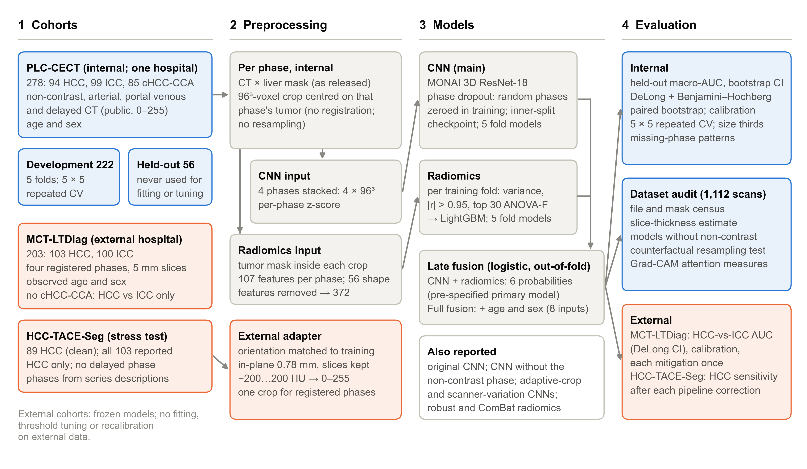
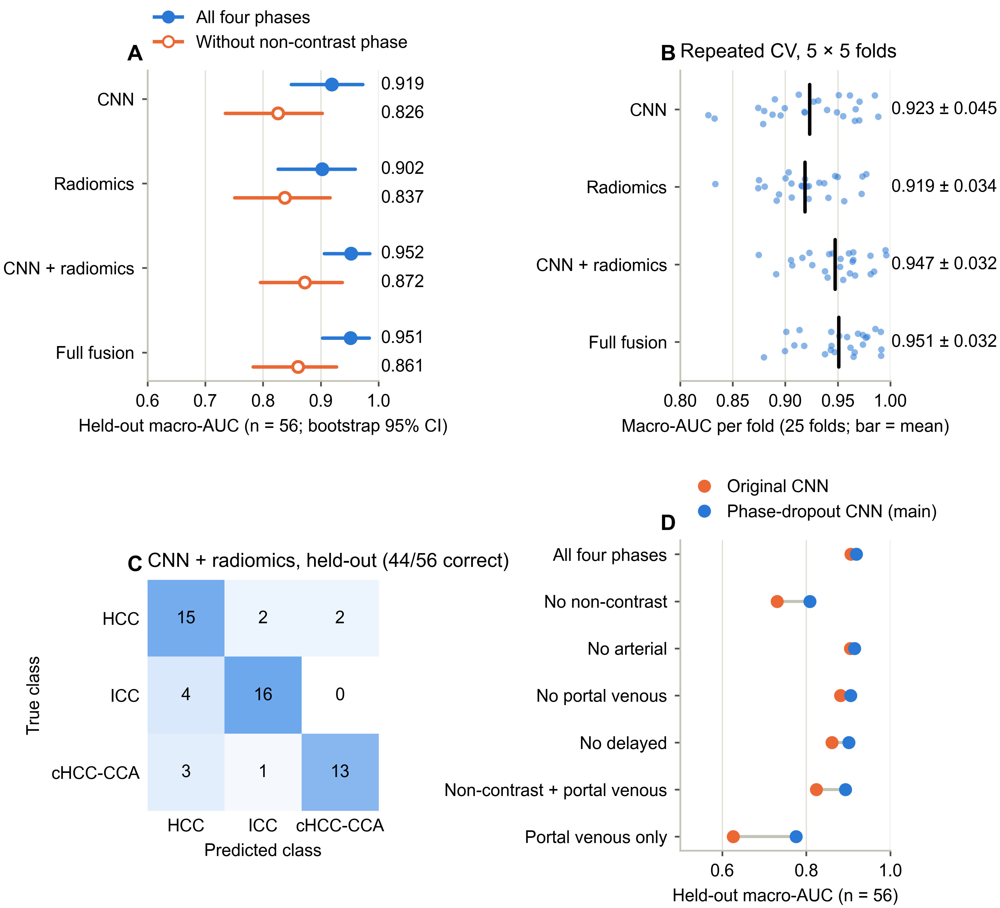
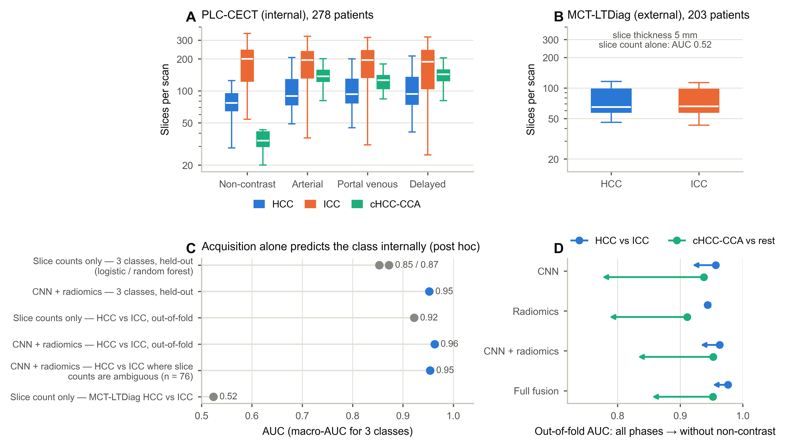
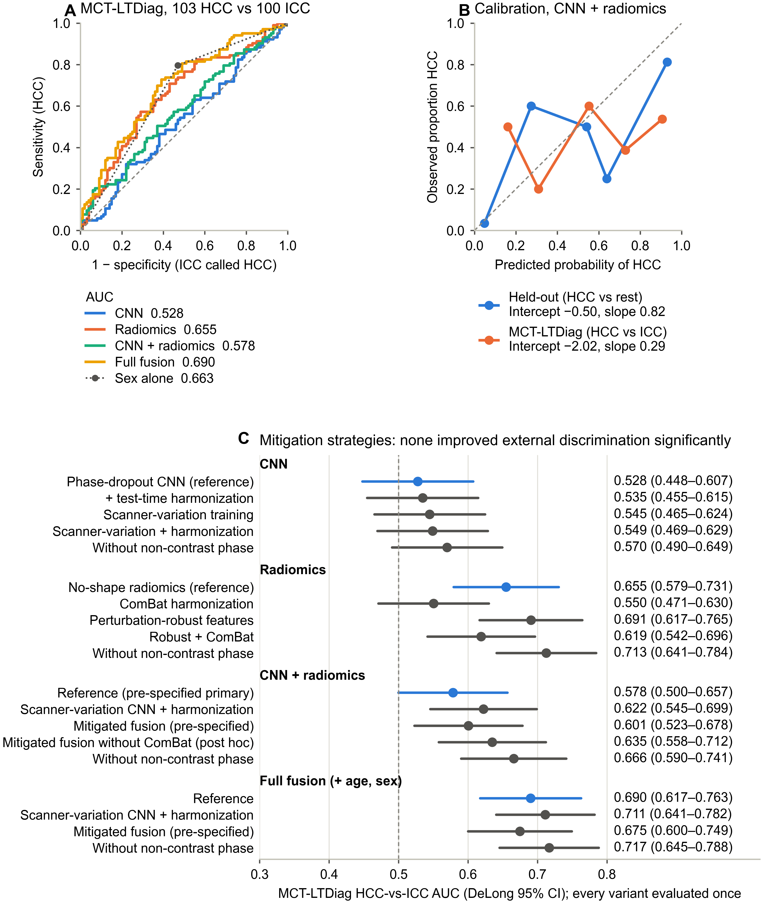

# Multimodal Liver Tumor Classification on Multiphase CT

[](https://github.com/hamzaelmassaoudy/multimodal-liver-tumor-classification/actions/workflows/ci.yml)
[](LICENSE)
[](CHANGELOG.md)
[](pyproject.toml)

Code, notebooks, and cohort-level results for **"Multimodal Classification of Primary Liver
Tumors on Multiphase CT: Internal Performance, Acquisition Artifacts, and Limited External
Transportability"**. The study distinguishes hepatocellular carcinoma (HCC), intrahepatic
cholangiocarcinoma (ICC), and combined hepatocellular-cholangiocarcinoma (cHCC-CCA) with a 3D CNN,
radiomics, and late fusion; audits the public training dataset for acquisition artifacts; and
tests the models on an external cohort from another hospital.

**Start here:** [Quick start](docs/quickstart.md) · [Revision overview](docs/revision_2026-10.md) ·
[Dataset audit](docs/plc_cect_dataset_audit.md) · [Notebooks](notebooks/README.md) ·
[Results](results/README.md) · [Documentation](docs/README.md)

## Key findings

| Finding | Evidence |
|---|---|
| Combining CNN and radiomics gives the best internal discrimination, but no per-class DeLong test survives correction | CNN + radiomics held-out macro-AUC **0.952** (95% CI 0.906–0.985); 0.942 ± 0.011 over 5 × 5 repeated cross-validation; smallest Benjamini–Hochberg-adjusted DeLong p = 0.13 |
| Age and sex add nothing | Full fusion − CNN + radiomics: −0.001 (−0.016 to 0.016) held-out; −0.006 (−0.024 to 0.013) in the pre-specified comparison |
| Acquisition is confounded with class in PLC-CECT | Slice counts alone predict the class (held-out macro-AUC 0.853–0.872); anatomical estimates indicate class-dependent slice thickness |
| The CNN uses a dataset artifact | Counterfactual test: injecting the thick cHCC-CCA non-contrast reconstruction raises p(cHCC-CCA) by 0.25 (0.21–0.30); repairing it lowers it by 0.50 (0.42–0.58) |
| Internal performance does not transport | MCT-LTDiag (103 HCC, 100 ICC): CNN + radiomics HCC-vs-ICC AUC **0.578** (0.500–0.657); calibration failed; no mitigation strategy helped significantly |

The models are research software and are **not suitable for clinical use**.

## Run without patient data

Create and activate a virtual environment ([Windows or macOS/Linux](docs/quickstart.md)), then from
the repository root:

```bash
python -m pip install -e ".[test]"
python scripts/smoke_test.py
python examples/synthetic_fusion.py
python -m pytest -q
python scripts/validate_release.py
```

The smoke test ends with `Public-clone smoke test passed`, and the release validation with
`Release validation passed.` These commands download no dataset and train no model. Python 3.10 or
newer is required; the [environment page](docs/environment.md) lists tested versions.

## Study design



## Internal results (PLC-CECT, held-out n = 56)

| Model | Held-out macro-AUC (95% CI) | 5 × 5 repeated CV, out-of-fold | Retrained without non-contrast phase |
|---|---:|---:|---:|
| Phase-dropout CNN | 0.919 (0.849–0.973) | 0.918 ± 0.018 | 0.826 |
| Radiomics (no shape features) | 0.902 (0.826–0.960) | 0.918 ± 0.005 | 0.837 |
| **CNN + radiomics** | **0.952 (0.906–0.985)** | **0.942 ± 0.011** | 0.872 |
| Full fusion (+ age, sex) | 0.951 (0.903–0.984) | 0.947 ± 0.011 | 0.861 |



All numbers are in [`results/revision_2026-10`](results/revision_2026-10/README.md); the
[revision overview](docs/revision_2026-10.md) explains each analysis.

## Dataset audit

A file-level census of all 1,112 PLC-CECT scans showed that patient numbers were assigned in class
blocks, slice counts differ systematically by class (median portal-venous slices: HCC 93, ICC 195,
cHCC-CCA 126), and the cHCC-CCA non-contrast scans have about 3.5 times thicker slices than the
same patients' contrast scans, and three-channel storage occurs almost only in ICC (87 of 99
patients). MCT-LTDiag has 5 mm slices in both classes. Anyone training on
PLC-CECT should read the [dataset audit](docs/plc_cect_dataset_audit.md).



## External validation

| Cohort | Model | Result |
|---|---|---|
| MCT-LTDiag (103 HCC, 100 ICC) | CNN + radiomics (pre-specified primary) | AUC 0.578 (0.500–0.657) |
| | Radiomics | AUC 0.655 (0.579–0.731) |
| | Full fusion (sex alone: 0.663) | AUC 0.690 (0.617–0.763) |
| HCC-TACE-Seg (89 HCC, stress test) | Phase-dropout CNN, after pipeline corrections | 47/89 HCC recognized (sensitivity only) |



## Repository map

| Path | Contents |
|---|---|
| [`src/liver_tumor_pipeline`](src/liver_tumor_pipeline) | Tested utilities: preprocessing contracts, fusion features, metrics, release validation |
| [`notebooks`](notebooks/README.md) | 27 notebooks: the original workflow (01–14) and the revision analyses (15–27) |
| [`scripts`](scripts) | Aggregate checks, release validation, and the [revision scripts](scripts/revision) |
| [`results`](results/README.md) | Cohort-level tables and figures: v1.1.0 (`aggregate`) and revision (`revision_2026-10`) |
| [`docs`](docs/README.md) | Methods, datasets, reproducibility, model card, and privacy boundary |
| [`tests`](tests) | Unit, integrity, and release-safety tests run in CI |

## Data, privacy, and citation

Obtain PLC-CECT V4 from [Science Data Bank](https://doi.org/10.57760/sciencedb.12207),
MCT-LTDiag from [Harvard Dataverse](https://doi.org/10.7910/DVN/S3RW15), and HCC-TACE-Seg from
[TCIA](https://www.cancerimagingarchive.net/collection/hcc-tace-seg/), following each provider's
terms. Patient images, masks, clinical rows, splits, predictions, and checkpoints are not
distributed here; see the [privacy boundary](docs/privacy_and_data_boundary.md).

Cite the software with [CITATION.cff](CITATION.cff). The
[v1.1.0 release](https://github.com/hamzaelmassaoudy/multimodal-liver-tumor-classification/releases/tag/v1.1.0)
remains the reference for the originally submitted analysis; changes since then are listed in the
[changelog](CHANGELOG.md). Contributions follow [CONTRIBUTING.md](CONTRIBUTING.md).
Repository materials use the [MIT License](LICENSE); source datasets keep their own terms.
