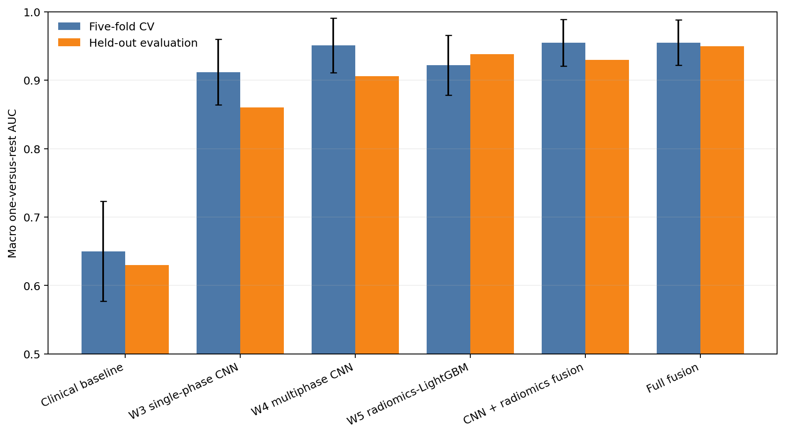
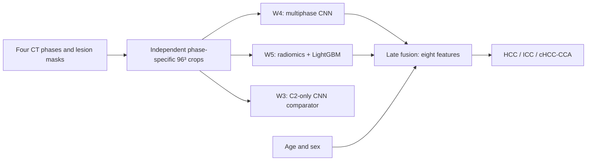

# Multimodal Liver Tumor Classification

[](https://github.com/hamzaelmassaoudy/multimodal-liver-tumor-classification/actions/workflows/ci.yml)
[](LICENSE)
[](https://github.com/hamzaelmassaoudy/multimodal-liver-tumor-classification/releases/tag/v1.1.0)

Code and aggregate results for three-class liver tumor classification on multiphase CT.
The notebooks document the study workflow, and the scripts check the released aggregate
analyses. The study combines a multiphase CNN, crop-restricted radiomics, age, and sex
through late fusion to distinguish hepatocellular carcinoma (HCC), intrahepatic
cholangiocarcinoma (ICC), and combined hepatocellular-cholangiocarcinoma (cHCC-CCA).

**Start here:** [Quick start](docs/quickstart.md) · [Documentation](docs/README.md) ·
[Notebooks](notebooks/README.md) · [Results](results/README.md) ·
[Reproducibility](docs/reproducibility.md)

## Run without patient data

Clone the repository, then create and activate a virtual environment using the
[Windows or macOS/Linux instructions](docs/quickstart.md).
From the repository root, run:

```bash
python -m pip install -e ".[test]"
python scripts/smoke_test.py
python examples/synthetic_fusion.py
python -m pytest -q
```

The smoke test ends with `Public-clone smoke test passed`. The example prints a
`(6, 8)` training matrix and a `(2, 8)` evaluation matrix. It uses explicitly synthetic
inputs to show how training-fold median imputation precedes fusion feature construction.
These commands download no datasets and train no imaging models.

Python 3.10 or newer is required. The [tested public-tools environment](docs/environment.md)
records the versions used for local checks; it does not reconstruct the historical
training environment. Imaging notebooks require the optional `.[workflow]` dependencies
and the inputs listed in the [notebook guide](notebooks/README.md).

## Study design and results

The internal PLC-CECT V4 cohort contains 278 patients: 94 HCC, 99 ICC, and 85 cHCC-CCA.
A patient-level split assigns 222 patients to five-fold development and 56 to held-out
evaluation. All phases from a patient remain in the same partition.

| Model | Development CV macro-AUC, mean ± SD | Held-out macro-AUC (95% CI) |
|---|---:|---:|
| Clinical baseline | 0.649 ± 0.073 | 0.614 (0.499–0.721) |
| W3: single-phase CNN | 0.912 ± 0.048 | 0.860 (0.784–0.928) |
| W4: multiphase CNN | 0.951 ± 0.040 | 0.906 (0.829–0.971) |
| W5: radiomics-LightGBM | 0.922 ± 0.044 | 0.938 (0.879–0.979) |
| CNN + radiomics | 0.955 ± 0.034 | 0.930 (0.854–0.986) |
| Full fusion | 0.955 ± 0.033 | 0.945 (0.890–0.984) |



Full fusion classified 45/56 patients correctly (accuracy 0.804, macro-F1 0.805).
Its AUC advantage did not establish superiority in the nine multiplicity-adjusted DeLong
comparisons. W4 had the highest held-out accuracy. See the
[aggregate tables and provenance](docs/results_provenance.md) for the remaining metrics,
exploratory tests, and historical encoding sensitivity analysis.

## Pipeline



The fusion vector contains the three W4 probabilities, the three W5 probabilities, age,
and sex, in that order. W3 is a comparator. Missing clinical values are imputed using
training-fold medians before the public constructor receives them.
[Feature order and imputation](docs/fusion_definition.md) and
[preprocessing](docs/preprocessing.md) describe the implementation.

## External stress test and limits

The external HCC-TACE-Seg cohort contains 103 known-HCC patients, so it measures HCC
sensitivity rather than three-class discrimination. No retained case has all four required
phases. W3 and W4 sensitivities were 0.049 and 0.000. Full-fusion sensitivity was 0.806
with missing clinical values replaced by internal training-fold medians, and 0.019 with
sex encoded as zero. These are model-defined scenarios. Radiomics sensitivity depended
strongly on feature imputation; Condition C used an internal diagnostic refit.
See [external results and controls](docs/external_stress_test.md).

The public release supports aggregate checks, synthetic examples, and inspection of the
workflow. Exact end-to-end reconstruction remains limited by missing W3 fold 1 and W4
fold 0 checkpoints, source geometry, and crop coordinates. Phases were independently
centered without registration; radiomics used unit-spacing crop arrays. CV and stacking
estimates also have the [limitations documented here](docs/reproducibility.md).

## Data, citation, and contributions

Obtain PLC-CECT V4 from [Science Data Bank](https://doi.org/10.57760/sciencedb.12207) and
HCC-TACE-Seg from [TCIA](https://www.cancerimagingarchive.net/collection/hcc-tace-seg/),
following each provider's terms. Patient images, masks, clinical rows, splits, predictions,
and checkpoints are not distributed here. See [dataset access](docs/datasets.md).

Use [CITATION.cff](CITATION.cff) to cite the software. The existing
[v1.1.0 study release](https://github.com/hamzaelmassaoudy/multimodal-liver-tumor-classification/releases/tag/v1.1.0)
remains the fixed reference; subsequent changes are recorded in [CHANGELOG.md](CHANGELOG.md).
Contributions follow [CONTRIBUTING.md](CONTRIBUTING.md).
Repository-authored materials use the [MIT License](LICENSE); source datasets retain their
own terms. This software is for research and is not intended for clinical decisions.
